# Folidock

An open-source B2B SaaS starter with a marketing site, CRM and outbound workspace, and an owner console. Clone it to start a product with real screens and working demo flows.

[Live demo](https://folio-crm-demo.vercel.app/) · [Open CRM](https://folio-crm-demo.vercel.app/crm/overview) · [Owner console](https://folio-crm-demo.vercel.app/admin) · [Use this template](https://github.com/matt-warchol/b2b-boilerplate/generate)

## What’s inside

| Screen | What you can try |
| --- | --- |
| [Marketing site](https://folio-crm-demo.vercel.app/) | Tailark OSS landing blocks, product tour, FAQ, and Motion animations. |
| [CRM](https://folio-crm-demo.vercel.app/crm/overview) | Interactive dashboard, contact and company records, tasks, and account settings. |
| [Campaigns](https://folio-crm-demo.vercel.app/crm/campaigns) | Create a draft, edit the sample sequence, and start or pause a send simulation. |
| [Inbox](https://folio-crm-demo.vercel.app/crm/inbox) | Read sample conversations and save reply drafts. |
| [Pipeline](https://folio-crm-demo.vercel.app/crm/pipeline) | Drag deals between stages, reorder cards, or use the stage menu. Totals update as you move deals. |
| [Owner console](https://folio-crm-demo.vercel.app/admin) | Search customer accounts, review sample MRR, and edit plans, status, seats, and notes. |
| [Feedback agent](docs/FEEDBACK.md) | In-app chat for questions and feedback, with user/page context, admin analysis at `/admin/feedback`, PostHog events and daily email digest. Needs Supabase and server-side AI credentials; disabled until configured. |

## Visual styles

Style switches the landing, CRM, and owner console together. It saves your choice in the browser and puts `?theme=` in the URL so you can share the current screen. Set the default in [`content/site.ts`](content/site.ts) and customize the shared CSS tokens in [`app/themes.css`](app/themes.css).

### Zinc

Neutral gray, split intro, full-width preview. [Open landing](https://folio-crm-demo.vercel.app/?theme=zinc) · [Open dashboard](https://folio-crm-demo.vercel.app/crm/overview?theme=zinc)

<table>
<tr>
<td width="50%"><a href="https://folio-crm-demo.vercel.app/?theme=zinc">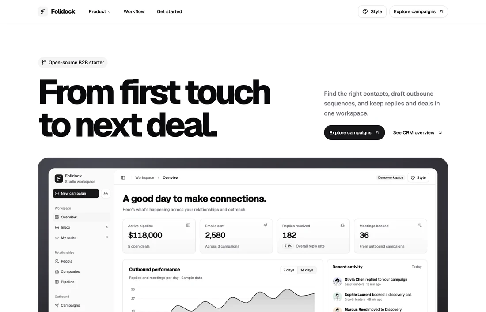</a></td>
<td width="50%"><a href="https://folio-crm-demo.vercel.app/crm/overview?theme=zinc">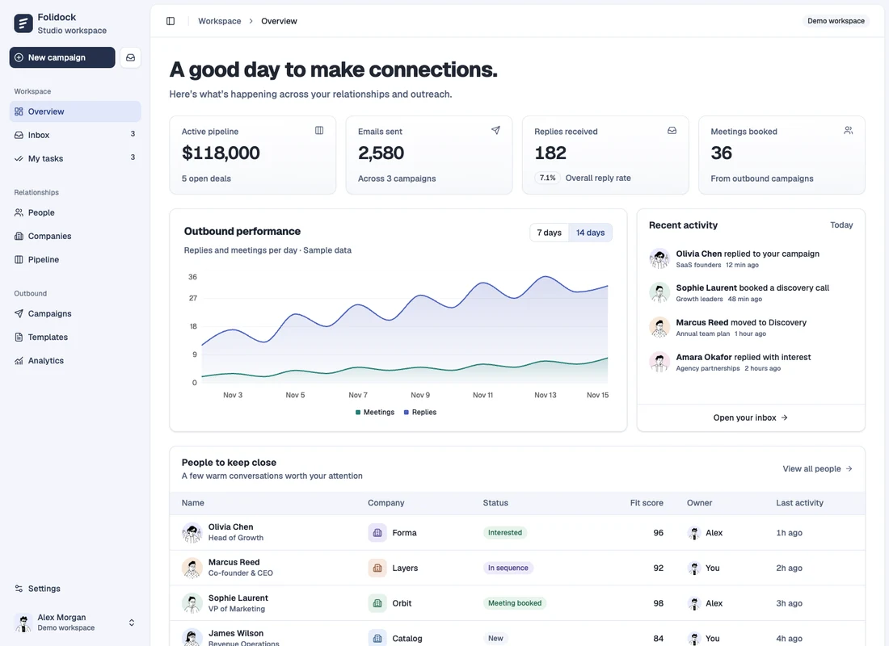</a></td>
</tr>
</table>

### Editorial

Warm neutrals, centered hero, serif headings. [Open landing](https://folio-crm-demo.vercel.app/?theme=editorial) · [Open dashboard](https://folio-crm-demo.vercel.app/crm/overview?theme=editorial)

<table>
<tr>
<td width="50%"><a href="https://folio-crm-demo.vercel.app/?theme=editorial">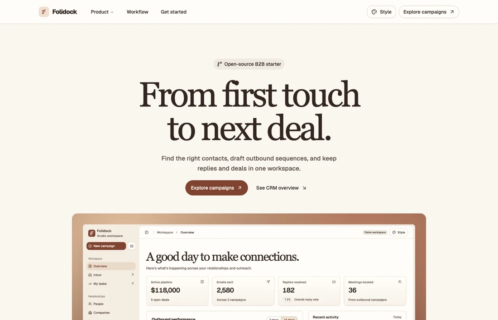</a></td>
<td width="50%"><a href="https://folio-crm-demo.vercel.app/crm/overview?theme=editorial">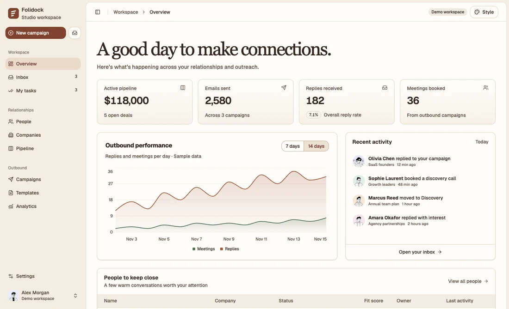</a></td>
</tr>
</table>

### Technical

Dark graphite, mint, side-by-side hero and a denser CRM. [Open landing](https://folio-crm-demo.vercel.app/?theme=technical) · [Open dashboard](https://folio-crm-demo.vercel.app/crm/overview?theme=technical)

<table>
<tr>
<td width="50%"><a href="https://folio-crm-demo.vercel.app/?theme=technical">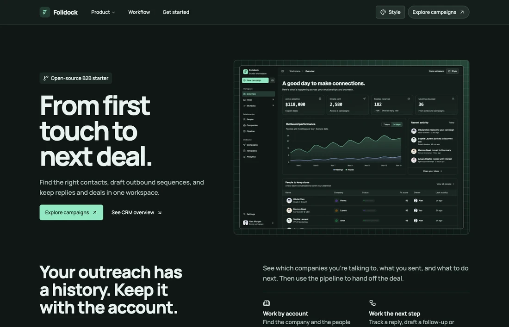</a></td>
<td width="50%"><a href="https://folio-crm-demo.vercel.app/crm/overview?theme=technical">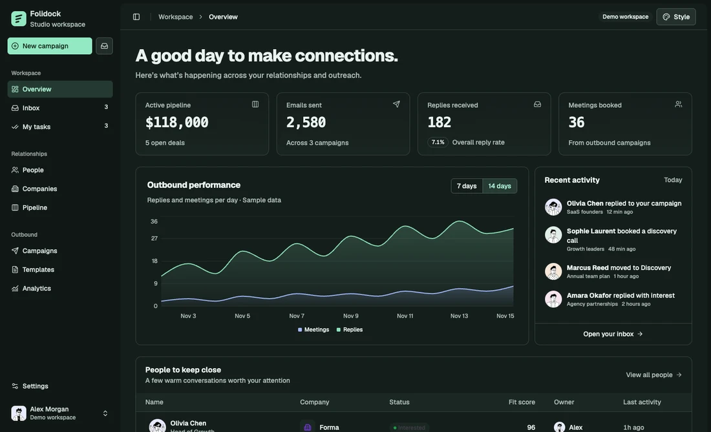</a></td>
</tr>
</table>

## Product screenshots

<table>
<tr>
<td width="50%"><a href="https://folio-crm-demo.vercel.app/crm/overview"></a><br><strong>CRM dashboard</strong></td>
<td width="50%"><a href="https://folio-crm-demo.vercel.app/crm/campaigns">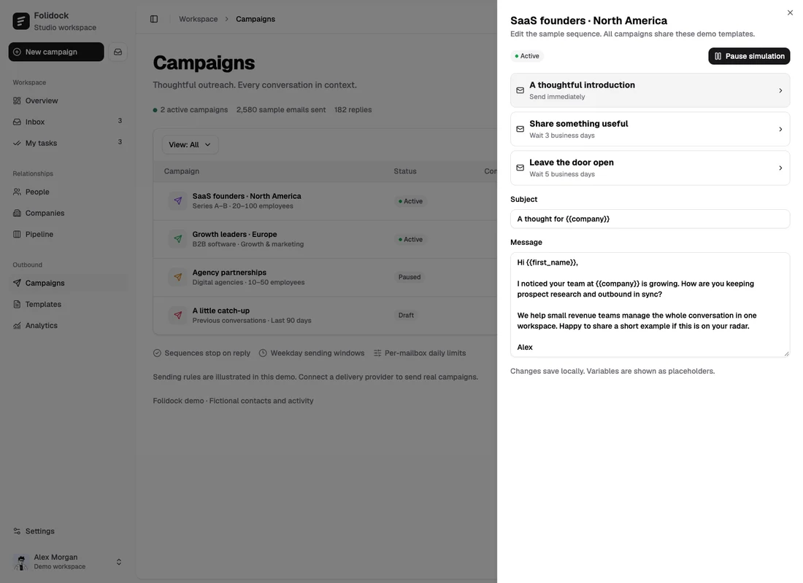</a><br><strong>Campaigns and sequence editor</strong></td>
</tr>
<tr>
<td><a href="https://folio-crm-demo.vercel.app/crm/inbox">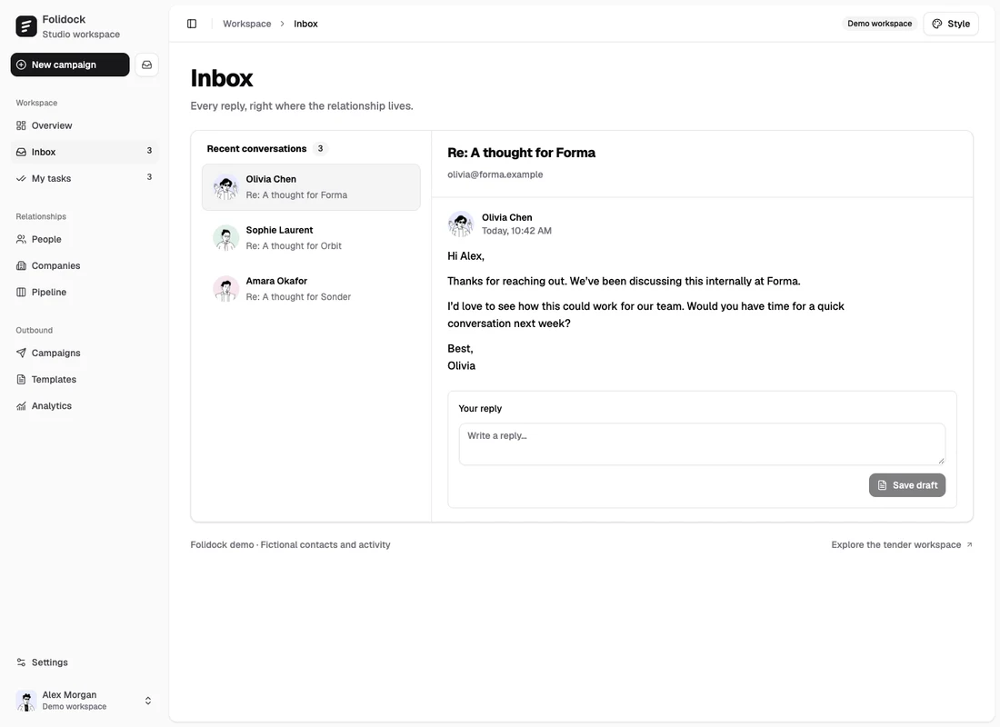</a><br><strong>Shared inbox</strong></td>
<td><a href="https://folio-crm-demo.vercel.app/crm/pipeline">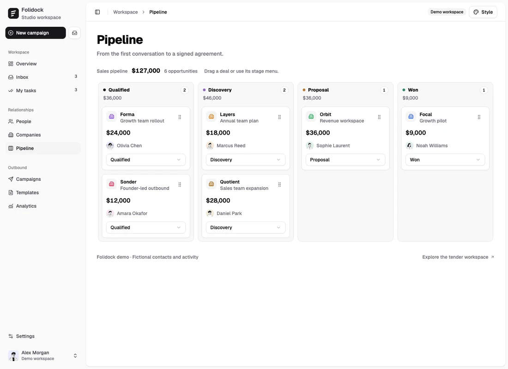</a><br><strong>Deal pipeline</strong></td>
</tr>
<tr>
<td><a href="https://folio-crm-demo.vercel.app/admin">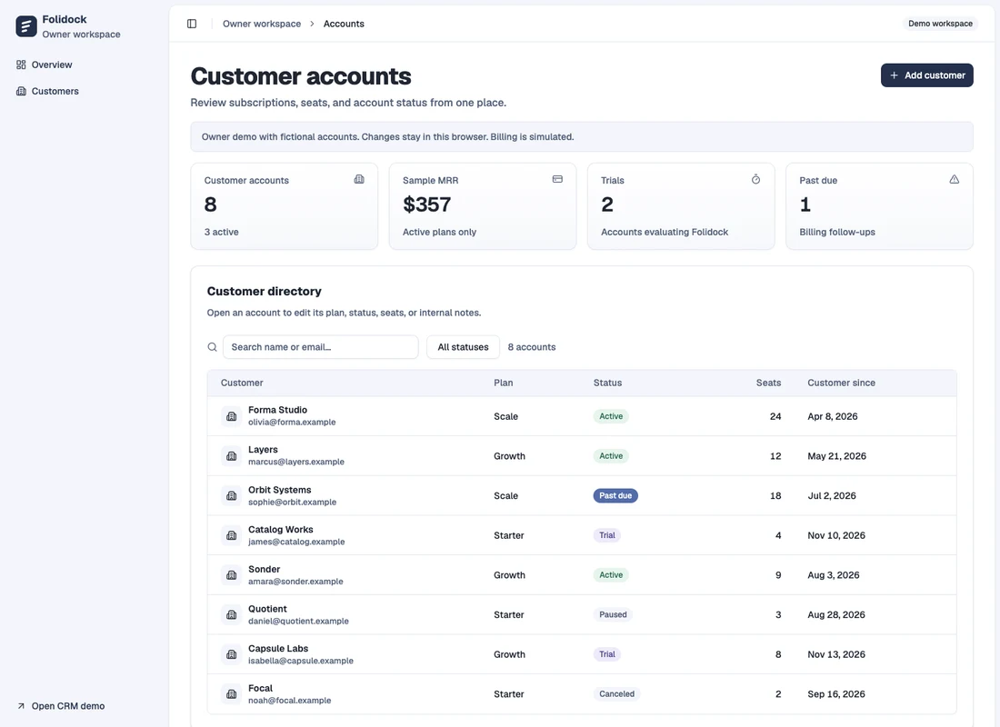</a><br><strong>Owner console</strong></td>
<td><a href="https://folio-crm-demo.vercel.app/crm/people">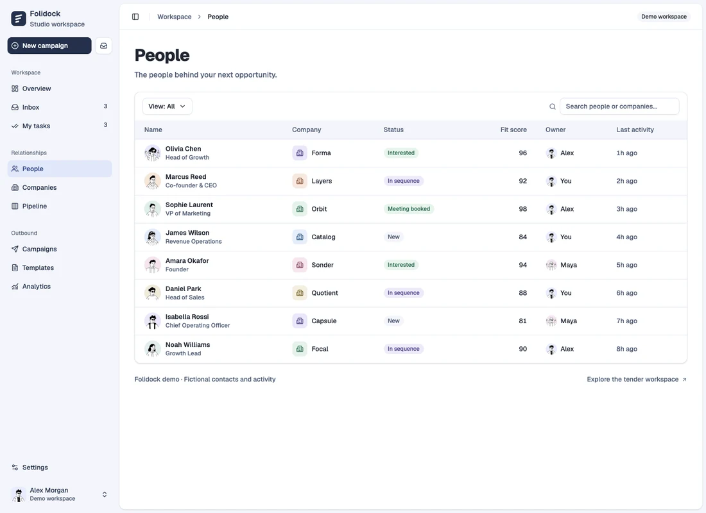</a><br><strong>Contact directory</strong></td>
</tr>
</table>

## Feedback agent

A ready-made module for product feedback. A small chat inside the product (not on the public site) that answers questions from a knowledge base and collects what users want improved, in any language. Every message is saved with the user, workspace and page, sent to PostHog, listed at `/admin/feedback` by topic and by user, and summarized daily by email. A button there copies a ready prompt plus the data, so you can analyze it with Claude. Limits per user, session and workspace and a daily cost cap keep it cheap (Claude Haiku by default). Setup and porting to another product: [docs/FEEDBACK.md](docs/FEEDBACK.md).

The demo runs on fictional data. Edits persist in your browser. Sending and billing are simulated. The original DealRadar example is also included at [the tender workspace](https://folio-crm-demo.vercel.app/workspace) and has a [bid brief builder](https://folio-crm-demo.vercel.app/workspace/briefs).

## Planned paid configuration wizard

The paid wizard is a [product roadmap item](docs/ROADMAP.md), not a shipped feature. It will guide project setup, module selection, secure integrations, and deployment, with an optional [Logo Generator](docs/LOGO-GENERATOR.md).

The [logo-generation skill](.agents/skills/b2b-logo-generator/SKILL.md) is available now for manual use in your own AI agent: six icon concepts crossed with six wordmark/layout treatments (36 draft full-logo options), rationale and prompts, and refinement of selected combinations. Existing icon selections narrow the matrix; three icons produce 18 options. Image rendering depends on available tools; low quality is used only when supported. Wizard UI, image-provider integration, SVG/favicon export, and automatic branding are planned.

## Run locally

Use Node.js 22 or newer.

```sh
git clone https://github.com/matt-warchol/b2b-boilerplate.git
cd b2b-boilerplate
npm ci
npm run dev
```

Open [localhost:3000](http://localhost:3000). Use `npm run ui:catalog` to refresh the component/props inventory and `npm run check` for lint, types, and a production build.

## Build on it

- **Start a project:** use the GitHub template and customize [site settings](content/site.ts), [landing blocks](components/marketing/blocks.tsx), [CRM records](features/crm/data.ts), and [owner demo accounts](features/admin/customers.ts).
- **Work with Claude Code or Codex:** follow the [step-by-step AI Start/Audit guide](docs/USING-WITH-AI.md), inspect the [installed components and props](docs/design-system-docs.md), then use the [starter skill](.agents/skills/b2b-starter/SKILL.md). The [shadcn-first workflow](DESIGN.md#shadcn-first-workflow) checks reuse before and after implementation.
- **Add product email:** use the [email module and audit checklist](docs/EMAIL.md) for seven React Email templates, a local preview, and dry-run Resend delivery.
- **Go to production:** see the [production guide](docs/PRODUCTION.md) for authorization, persistence, billing, email, and optional AI cost controls.

Folidock uses Next.js, TypeScript, Tailwind CSS, shadcn/ui, Tailark OSS, Dice UI Kanban with dnd-kit, Recharts, TanStack Table, Motion for React, and Lucide. The [UI audit](docs/UI-AUDIT.md) shows which pieces came from ready-made blocks and what was adapted. The starter is [MIT licensed](LICENSE).
