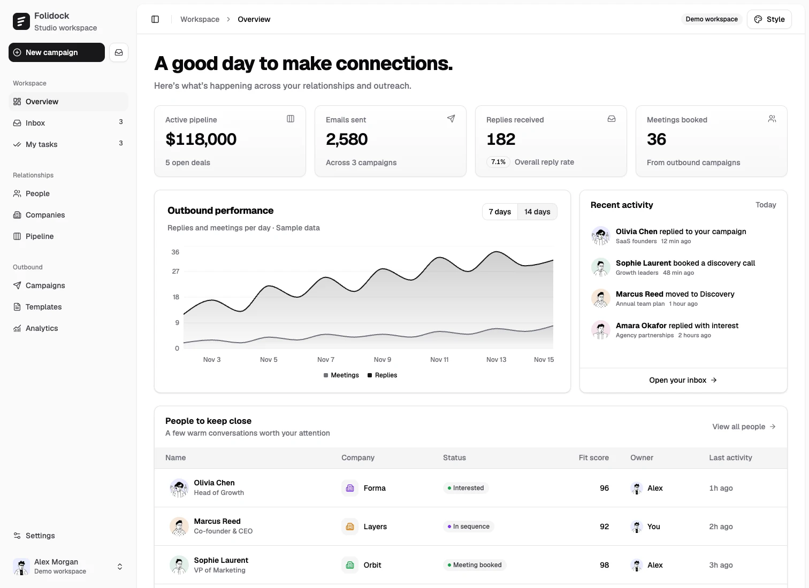

# B2B Product Starter

An open-source starting point for B2B products that sell on a landing page and do the daily work in a CRM-style workspace. It also includes a playbook for auditing a product you already have.



The main demo is **Folio**, a CRM with ten connected views. Explore people and companies, move deals through a pipeline, create an outbound campaign, edit its three-step sequence, and save reply drafts. The cool neutral design is inspired by Attio and Warmbly, with original identity marks and subtle Motion interactions.

All contacts, companies, and campaign metrics are fictional. Sending is simulated. Campaign drafts, sequence edits, deal stages, tasks, reply drafts, and workspace preferences persist in this browser. Campaigns currently share one set of demo sequence templates. The original DealRadar tender workflow remains available under `/workspace`.


## Run it

Use Node.js 22 or newer. Node.js 24 is used in CI.

```sh
git clone https://github.com/matt-warchol/b2b-boilerplate.git
cd b2b-boilerplate
npm ci
npm run dev
```

Open [localhost:3000](http://localhost:3000). Run `npm run check` for lint, types, and a production build.

| Route | What you can try |
| --- | --- |
| `/` | Folio landing with responsive screenshots and a direct CRM demo link |
| `/crm/overview` | Relationship dashboard, sample activity, outbound charts and people |
| `/crm/people`, `/crm/companies` | Searchable records, filtered views and contact details |
| `/crm/pipeline` | Editable deal stages in a kanban board |
| `/crm/campaigns` | Create drafts, edit sequence copy, start or pause simulations |
| `/crm/inbox` | Sample conversations and saved reply drafts |
| `/crm/tasks`, `/crm/templates` | Task completion and reusable sequence copy |
| `/crm/analytics`, `/crm/settings` | Sample performance and local preferences |
| `/workspace` | Search, sort, filter, open and edit opportunities; changes persist in this browser |
| `/workspace/briefs` | Generate a draft from a record, edit it, then copy or download it |

The demo uses fictional records. There is no live tender feed, database, login, email delivery, or hosted AI in the starter.

## Start a project or audit an existing one

- **Start:** use **Use this template** on GitHub or copy this folder into your project. Open it in Claude Code or Codex and say: “Use b2b-starter to start [product]. Recommend a landing and workspace style, then build the first workflow.” Claude Code can also run `/b2b-starter start`; Codex can run `$b2b-starter` with the task. The [project brief](docs/PROJECT_BRIEF.md) captures audience, offer, evidence, and one conversion action.
- **Audit:** point Claude Code or Codex at your existing repo and share the target URL or route and its main business goal. Say: “Use b2b-starter to audit this project. Prioritize fixes with screenshots or code references.” You can use [the audit playbook](docs/AUDIT.md) on its own; there is no need to replace your current stack.
- **Make it yours:** swap [landing copy and CTA](content/site.ts), choose a [style](DESIGN.md), replace [sample records](features/opportunities/model.ts), change the brand in [the brand component](components/brand.tsx), and recapture the preview from your first working workflow. Replace the demo favicon and point the footer link at your new repo.

## What it uses

[Next.js App Router](https://nextjs.org/docs/app) and TypeScript; [Tailwind CSS](https://tailwindcss.com/) and local [shadcn/ui](https://ui.shadcn.com/) patterns built on [Radix Dialog](https://www.radix-ui.com/primitives/docs/components/dialog); [TanStack Table](https://tanstack.com/table/v8/docs/overview) for record views; [Lucide](https://lucide.dev/) icons and [Motion](https://motion.dev/docs/react-accessibility) for the active view indicator.

Use the [shadcn blocks](https://ui.shadcn.com/blocks) and [Cruip Simple Light](https://github.com/cruip/tailwind-landing-page-template) as references when adding sections. Check the license of each block, font, image, and icon you import. Attio is a workspace design reference; the starter uses its own UI and assets.

See [production next steps](docs/PRODUCTION.md) for auth, persistence, invitations, and cost controls for optional AI. The starter code is [MIT licensed](LICENSE). Contributions can start with a small PR and a screenshot or reproduction for any change the user can see.
